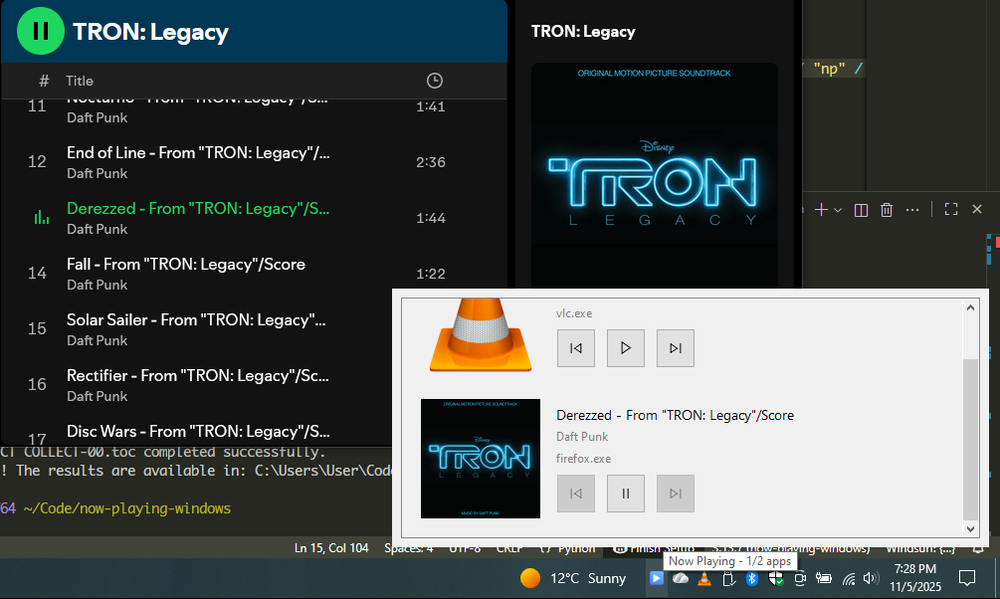

# 🎵 Now Playing

A lightweight tray application that displays media information from all applications broadcasting on **GlobalSystemMediaTransport**.  
It also provides **basic media controls** such as **Play, Pause, Next, and Previous**.

---

## ✨ Features

- 🎧 Displays real-time media info from apps broadcasting via GlobalSystemMediaTransport
- 🖼️ Shows thumbnail, title, and artist name
- ▶️ Basic playback controls:
  - Play / Pause  
  - Next track  
  - Previous track
- ⏱️ Live track progress with elapsed / total time
- 🌗 Follows the Windows light / dark theme automatically
- 🎨 UI built with Qt Designer (`.ui` files) and a themeable stylesheet
- 🧭 Cross-app control support (where the media source allows it)

---
## 🎥 Screenshot(s)
> Screenshots may be outdated


---

## 📦 Installation

```bash
uv tool install git+https://github.com/raffleberry/now-playing
```
or 
Download it from [releases](https://github.com/raffleberry/now-playing/releases).

---

## 🛠️ Development

Requires Windows 10/11, Python 3.13 and [uv](https://docs.astral.sh/uv/).

```bash
uv sync
uv run np
```

### UI

Layouts live in `np/ui/*.ui` and can be edited with Qt Designer:

```bash
.venv/Scripts/pyside6-designer.exe np/ui/main_window.ui
```

The Python UI modules and the embedded resources are generated after editing:

```bash
uv run python scripts/generate_resources.py
```

- `np/ui/ui_*.py` – generated from the `.ui` files (do not edit by hand)
- `resources/styles/theme.qss` – theme stylesheet (color placeholders)
- `np/theme.py` – light / dark palettes and Windows theme detection
- `np/iconset.py` – SVG icons recolored to match the theme

### Build

```bash
uv run python scripts/build.py
```
